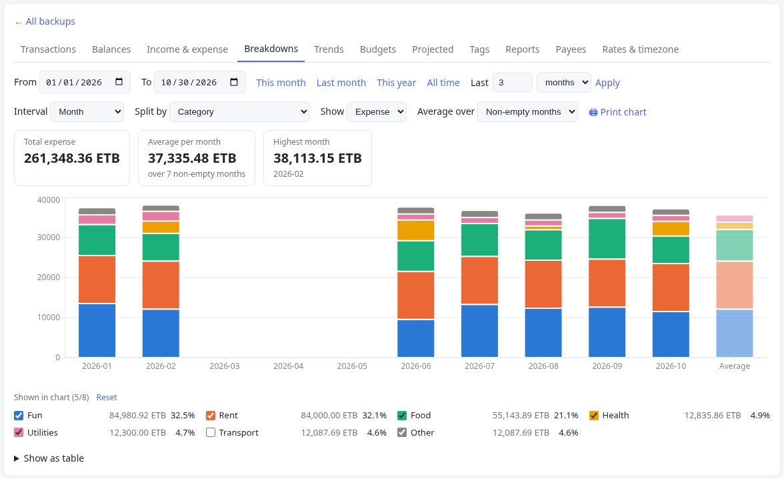

*Last time: the app opened a real backup for the first time, after two failures that had nothing to do with the schema. With real data on screen, the charts had a new problem: too many categories.*

> **A note on names.** This tab is called **Breakdowns** today. On Oct 29 the name Trends moved to a new tab of calendar patterns, which gets its own chapter. This chapter describes the tab as it was on Oct 7–8, so it says Trends.

## TL;DR
- The Trends chart showed the 7 largest categories and folded the rest into a grey "Other". Which 7 was the chart's choice, not mine, and colors shuffled whenever the set changed.
- A checkbox legend now picks the categories or accounts that get their own bars. Each pick keeps its color, the top 5 are checked by default, and the cap is 8 because the palette has 8 colors that stay distinct for color-blind readers.
- Percentages in the tooltip and legend say what they are out of. A dimmed Average bar sits after the last period.
- I asked Claude Code to discuss the design before writing code. Its questions turned out to be the design.

## The chart before

The Trends tab draws stacked bars over time: income and expense, or expense split by category or account. On Oct 7 it worked like this, in `FlowReports.tsx`:

- It added up each group's total over the date range, kept the **top 7**, gave them colors and merged everything else into a grey "Other".
- The legend was the built-in Recharts legend. You could read it, but you couldn't click it.
- Colors came from 8 theme tokens (`--series-1` to `--series-8`). Each was assigned by sorting the visible groups by id, so a category could change color when another one appeared.

Which categories got their own bars was the chart's choice, not mine.

## Discuss first, build second

I wrote the feature as one paragraph: a checkbox per category under the chart, the checkbox showing the color, unchecked items folded into "Other", and a sensible default selection. It ended with a request:

> "Let's discuss this feature before moving to implementation to make sure you understand the vision."

Claude Code read the chart code first. Its reply had three parts: how the chart worked now, how it would build the feature, and the decisions it needed from me. The plan had details I hadn't asked for and would have wanted:

- **The checkbox shows the color without a custom widget.** A native checkbox takes CSS `accent-color`, so a checked box fills with its series color. I had offered a fallback (a color swatch on the right) in case this was hard. It wasn't needed.
- **"Other" has no checkbox.** It means "everything unchecked", so it sits last in the legend as a fixed grey row with its combined total.
- **Colors stay with the item.** Checking a box takes the lowest free color slot, and the item keeps it while you toggle others. Unchecking frees the slot.

Then the questions: how many items can be checked, how many are checked by default, and when the selection resets.

Most features after this one went the same way: a paragraph from me, questions from the agent, then code. The questions are where I made most of the decisions in this series.

## Why only 8 colors?

The agent proposed a cap of 8 checked items. My first answer was a question: "can't we have more than 8 colors? why are we limited to 8?"

The answer was about readability, not code. The 8 colors in the theme were validated in light and dark mode. Each pair that can sit side by side stays distinct for color-blind readers, and each color stands out from the background. Past about 8, two neighbouring segments in a stacked bar start to look alike, and color stops telling you which item a segment is.

Raising the cap would mean adding `--series-9` and up to the stylesheet. The agent said it was a small change and advised against it. A 9th item already has a place to go: "Other". I kept 8.

The cap shows in the UI. Once 8 items are checked, the remaining boxes are disabled with one line: "All 8 colors are in use. Uncheck one to add another."

## The defaults

The top 5 items by total are checked when the chart first loads. That leaves 3 colors free for my own picks. The legend header reads "Shown in chart (5/8)", with a **Reset** link that restores the defaults.

I also asked for each item's total next to its name, with a caveat: "see if it does not make it cluttered. might change it back." The agent made the total a single element per row, so removing it later would be a one-line change. It stayed.

## When should the picks reset?

This took two rounds, and the second one is the more interesting.

**Round one.** I said picks reset when "Split by" changes (a different list of items) or when the date range changes, plus a manual Reset. The agent built that, and added one rule of its own, which it flagged: switching between Expense and Income also reset the picks, because the two lists are mostly different categories.

**Round two, an hour later.** I stepped back:

> "Can we step back and not reset category selection when date range changes. So only reset when split by is changed or manual reset is invoked."

That sounds like deleting a condition. The agent found the case it would break. The legend only listed items with activity in the current range. Check "Coffee", move to a month with no coffee, and Coffee would vanish from the legend while still holding a color slot. There would be no box left to uncheck.

The fix: checked items stay in the legend at zero, and each pick stores the item's name along with its color slot, so the row can be drawn without data. One subtlety was left for me: if I haven't touched the picks since the last Reset, the 5 defaults are recomputed for each new range. They only freeze once I change something.

The general lesson is a question worth asking whenever state stops resetting: what becomes unreachable?

## Percentages that say what they are out of

A second request that night asked for percentages in the tooltip and the legend. They are two different fractions, and the UI says which:

- **Tooltip:** each item's share of *that period's* bar, for example `1,240.00 USD (31.4%)`. The tooltip header shows the bar's total, so you can see what 31.4% is of.
- **Legend:** each item's share of *all money in the range*, including "Other". It is computed against the overall total, not the checked items, so the percentages don't move when you check or uncheck something.

A small `fmtPct` helper does the formatting: one decimal place, `<0.1%` for a tiny share that isn't zero (instead of a misleading `0.0%`), and `—` when the total is zero. It has its own test.

## An Average bar

The third request: one more bar at the right end, showing the average of the displayed periods. With a breakdown, it should show the average of each checked item.

- The bar is dimmed so it reads as a summary, not as one more month.
- Without a breakdown, it shows an income average and an expense average side by side.
- With a breakdown, it stacks one average per checked item. "Other" gets none, since I asked for checked items only. The agent asked whether I wanted it included.
- "Show as table" gets an Average row too.

The agent ended with a caveat I didn't follow up on:

> "If the API leaves out a period with no transactions, it won't be counted as zero, so the average could come out higher than the true one. I haven't checked how the API handles that."

It was right, for the split view. That stayed hidden for three weeks, and it belongs to a later chapter.

## Three sessions, one file

These three features came from separate Claude Code sessions that I started over about ninety minutes, all editing the same uncommitted `FlowReports.tsx`. Nothing was committed between them.

It worked because each agent re-read the file before editing. When I went back to the legend session to change the reset rule, it noticed:

> "The file has changed since my last edit: an Average bar and percentage columns were added. I'll keep those and build this change on top of them."

The percentages session said the same about the legend: "I built this on top of your uncommitted pick-legend changes in the same files." I committed the lot the next day.

Every reply that night ended with some version of "typecheck, tests and build pass, but I haven't looked at it in a browser." That left the looking to me. A few chapters later, the agent learned to render the dashboard itself.

## Meanwhile, on the cluster

Between two of these features, I asked for the deploy script to record why each rollout happened. `kubectl rollout history` had been showing `<none>` for every revision. It's a short story about one annotation.

→ *Interlude: [Rollout history said `<none>`](/2026/11/03/rollout-history-said-none.html)*

## Takeaways
- **Ask for the discussion before the code.** A spec paragraph plus the agent's questions (the cap, the defaults, the reset rule) produced the design. The code was the short part.
- **A color limit is a readability limit.** Past about 8 categorical colors, neighbours look alike to color-blind readers. Fold the rest into "Other" instead of inventing a 9th color.
- **Give each item a sticky color.** If colors reshuffle when a filter changes, every chart is a new puzzle.
- **When state stops resetting, ask what becomes unreachable.** Here it was a checked item with no data and no row to uncheck it from.

## What's next

The next chapter reuses all of this for budgets, and finds out what the public API won't forward without being told.

*The story continues as the work does.*

---

*Built with Claude Code as a pair. What I directed, checked and changed is in the story.*

Source: [github.com/eyosias-k-negash/ivk8](https://github.com/eyosias-k-negash/ivk8). Commits: [`01cfe51`](https://github.com/eyosias-k-negash/ivk8/commit/01cfe51) (pick legend, percentages, Average bar), [`c819505`](https://github.com/eyosias-k-negash/ivk8/commit/c819505) (the reset rule).
