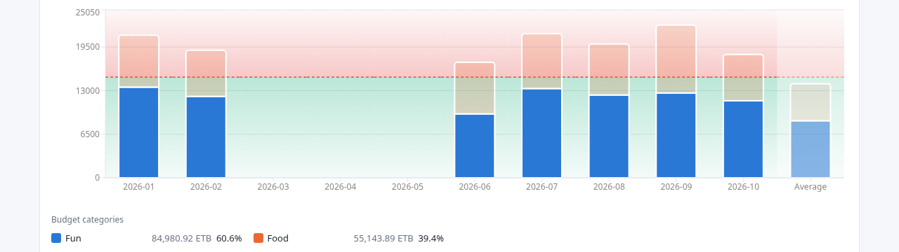

*Last time: the Trends chart got a checkbox legend, percentages and an Average bar, all from one night of spec, questions and code. This chapter uses the same parts for budgets, and runs into the public API's allowlist.*

## TL;DR
- Ivy Wallet+ stores budgets: a monthly amount and the categories it covers. The new Budgets tab stacks each period's spending in those categories against the budget, with a green zone below the limit and a red zone above it.
- The limit scales to the chart's interval by **exact calendar days**, not by "a week is a quarter of a month". That rule makes a year of weekly bars add up to 12 months of budget, not 13.
- The tab needed two new reports in the analytics service, and one word added to the public API's allowlist. I asked why, and the answer is the security model from the second chapter doing its job.
- Exchange rate overrides are now remembered per user in the browser. The server still stores nothing.

## The spec

On Oct 8 I wrote the Budgets tab as one long paragraph. The main points:

- It works like Trends: stacked bars over a selectable date range and interval.
- "Split by" is replaced by a dropdown of the budgets recorded in the backup. A budget's categories are the segments of each bar.
- A green gradient fills the area below the budget's limit, and a red-tinted zone covers the area above it.
- The limit adapts to the interval. Budgets are monthly, so a monthly bar uses the amount as it is, and "if weekly is selected it gets divided by 4".
- No checkboxes in the legend, because each budget already chooses its categories. The legend shows each category's total and its share.
- A dimmed Average bar at the right end, as in Trends.

It ended: "let's make clear any doubts and continue".

## Four questions

Claude Code read the Trends tab, the budget schema in the backup and the project's first decisions before asking anything. Then it asked four questions, each with a recommended answer:

| Question | Recommended | My answer |
|---|---|---|
| How does the limit scale per interval? | Day ÷30, Week ÷4, Month ×1, Year ×12, which "keeps your weekly ÷4 rule" | **Exact calendar days** |
| What counts as spending? | Expenses in the budget's categories, on all accounts | Recommended |
| How does overspending look? | The bar keeps stacking into the red zone behind it | Recommended |
| Build the API now, or reuse the existing time series? | Endpoint and tab together | Recommended |

The first row is the one where I changed my own spec. The second option read:

> "Exact calendar days: Monthly × (days in bucket ÷ days in that month). More accurate, but the line differs per bar and week ≠ ÷4."

The arithmetic behind it is short. A year has 52 weeks. At a quarter of the monthly budget per week, 52 weekly bars add up to 13 months of budget. Each bar would look a little more generous than it is, and the error adds up.

With calendar days, each day carries the monthly amount divided by the days in its own month. A month equals the budget exactly. A year is 12 times it. A week is seven days' worth, and a week that straddles two months takes its days from each. The price is the one the agent named: the limit line steps a little from bar to bar.

The second row has a quieter decision in it. A budget in the backup also has a list of accounts, and the agent's recommendation kept ignoring it. The project's first decisions, written before any feature, record that field as vestigial and ignored. So a budget counts spending in its categories wherever the money came from.

## What was built

**In the analytics service:**
- `budgets` lists the budgets in the backup: id, name, monthly amount and categories. It replaced a stub that had answered 501 since the first week.
- `budget-timeseries` takes a budget, a date range and an interval, and returns each period's limit plus the spend per category.
- Spending is executed expenses in the budget's categories, converted to the base currency. A currency with no exchange rate is listed in a warning instead of being dropped silently.

**In the dashboard:**
- A green-to-transparent gradient below each bar's limit, a dashed limit line, and a red-tinted zone above it, all drawn behind the bars. Overspending is the bar growing into the red.
- A dimmed Average bar with the mean spend per category and the mean limit, empty periods counted as zero, like Trends.
- A legend with each category's color, total and share. No checkboxes.

**Extras the agent added, and said so:** a tooltip with spent versus budget and the amount over or left, a one-line summary above the chart, and a "Show as table" section.

**Decisions it made and flagged:**
- **A partial period uses the whole period's limit.** "This month" with the Month interval compares spending so far against the full month's budget. Clipping the limit to the range would make the line less useful.
- **More than 8 categories:** the 7 largest are named and the rest fold into a muted "Other (n)". It's the same 8-color palette as Trends.
- **Budget amounts are assumed to be in the base currency.**

The tests passed and the build was clean. The agent hadn't seen the chart: "The green/red zones are the part most worth checking by eye."



## "What do you mean, a new report?"

The summary said a new report had been added "to the allowed list in drive-sync". I asked what that meant:

> "what do you mean a new budget-timeseries report? and why should it be in the allowed list in drive-sync? what does this mean, explain"

The answer walked the request path from the second chapter, one hop at a time:

```
web-dashboard  →  drive-sync-service (public API)  →  analytics-service (cluster-internal)
```

- In this codebase, each analytics endpoint is a **report**: `summary`, `timeseries`, `balances`, and now `budgets` and `budget-timeseries`. The dashboard asks for one by name at `/api/backups/<fileId>/<report>`.
- drive-sync is the only service the browser can reach. It checks the session, finds the backup in Drive and forwards the request to analytics.
- It forwards a report name only if the name is in a fixed set in its code, `REPORTS`. Anything else gets a 404 "Unknown report" before it reaches analytics.

So adding the route to analytics wasn't enough. Without `'budget-timeseries'` in that set, every request from the Budgets tab would have died at drive-sync. The change was one word.

The agent also offered the alternative it had turned down: one `budgets` report that returns the list without a budget id and the series with one. That avoids touching the allowlist. It chose two reports so that each response has one predictable shape.

This is the friction a fail-closed design is supposed to have. Every new report is a change in two places, and the second place is the public one. A browser can't ask analytics for a path nobody chose to expose. The projection and the custom reports, two features later, each add their own word to that set.

## Rates that stick

The second change that evening was smaller. Every report converts amounts to the base currency with daily ECB rates. A user can override any rate in the Rates table, for example a currency the ECB doesn't publish. Overrides lived in the page's memory, so they were gone on reload and had to be entered again for each backup.

> "we should remember exchange rates entered once, they should not be required to enter for each backup. If a logged in user enters an exchange rate it should be remembered"

The usual place to remember something per user is a server. The services don't store anything, by design, so the agent put it in the browser:

- Overrides are saved in `localStorage`, keyed by the signed-in email, and restored when that user signs in. A different account in the same browser doesn't see them.
- Editing a rate saves it. "reset" removes it.
- They still travel with every report request as query parameters, so the analytics service didn't change at all.

The design held. A report is still a pure function of the backup, the timezone and the overrides. The browser now remembers one of the inputs, and the server stays out of it.

The agent named the cost: the overrides live in one browser, so they don't follow you to another device. Syncing them would need a small per-user store in drive-sync, and that would be the project's first server-side state. It offered to build that. I left it in the browser. Saved report filters use the same pattern in the Reports chapter.

## Takeaways
- **Check the arithmetic of a convenient rule.** "A week is a quarter of a month" makes a year 13 months long. Scaling by days in the actual month is barely more code.
- **An allowlist makes every new endpoint a two-place change.** That's the price of failing closed. Pay it, and explain it the first time someone asks.
- **Decide what counts before you draw it.** The questions about spending rules shaped the numbers more than any color choice.
- **When the server stores nothing, the client can remember for the user.** Say what that costs: one browser, one device.

## What's next

The next chapter is the first one that looks forward instead of back: a projection of net worth. It took six rounds on one chart's axes, and it ended with one rule for money that every tab now shares.

*The story continues as the work does.*

---

Source: [github.com/eyosias-k-negash/ivk8](https://github.com/eyosias-k-negash/ivk8). Commits: [`f7430c0`](https://github.com/eyosias-k-negash/ivk8/commit/f7430c0) (Budgets tab and reports), [`7a69bb3`](https://github.com/eyosias-k-negash/ivk8/commit/7a69bb3) (remembered rate overrides).
