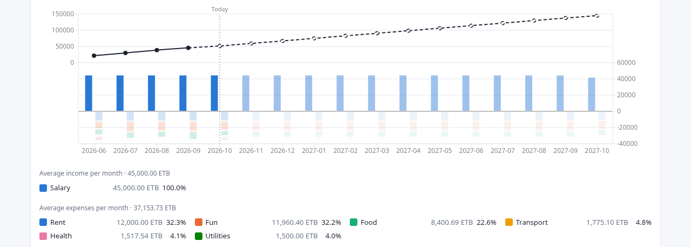

*Last time: a Budgets tab with green and red zones, and exchange rate overrides that the browser remembers. Every chart so far looked back. This one looks forward.*

## TL;DR
- A **Planned** tab projects net worth from transactions scheduled in the backup: income above zero, expenses below, and a net worth line on its own axis.
- The chart's two axes took six rounds of feedback. The answer wasn't aligning their zeros. It was giving the line its own band above the bars.
- Renamed **Projected**, the tab gained a second mode: project from today's balance using a moving average of recent months.
- To check that mode, Claude Code built a way to render the dashboard with no Google sign-in: a synthetic backup, a mock API and headless Chrome. Its first screenshot caught a bug the tests had passed.
- The same night I set the rules for what counts as income and expense, one correction at a time. They now live in one function, `moneyFlow`, used by every tab.

## The Planned tab

Ivy Wallet+ lets you schedule transactions: rent due on the 1st, a salary expected at month end. On Oct 9 I asked for a tab that uses them:

- It projects future net worth by applying the planned income and expenses.
- Bars show each period's planned income stacked above zero and planned expenses stacked below it.
- Projected net worth is a line. The bars use the right axis and the line uses the left.
- It has the tooltip and legend from Budgets, with category totals and percentages. No Average bar.

Claude Code built the `/planned` report, which had answered 501 since the first week, and the tab. The projection works like this:

- Net worth at the end of each period is every executed transaction plus every planned item due by then. Only accounts that count toward the balance are included.
- A planned item that is already overdue is assumed to happen on its due date. The summary line says so.
- The tab gets its own From and To dates, with "Next 3, 6, 12, 24 months" shortcuts and a default of the next 12 months. The shared range picker would have defaulted to the past.

One limit was stated up front. Recurring rules, the templates that create next month's rent, are not expanded forward. Only transactions that already have a due date count.

## Six rounds on two axes

The rest of Oct 9 went to one chart. Each round was a one-line request from me and a change from the agent. None of them were rendered by the agent; each reply ended with "I haven't checked it in a browser".

1. **The value under the cursor.** I asked for the exact money value at the mouse's height. The agent added a dashed guide line that follows the mouse, with a label giving the axis value there. It went into a shared `CursorValue` component used by Budgets, Trends and this chart, which gets two labels, one per axis.
2. **"Make the text on the outside of the chart, some bars are covering it."** The label moved into the axis margin.
3. **"The numbers are unreadable when they pass over the marker texts on the axes."** The mechanism was a layering rule. Recharts 3 draws axes and their tick numbers in a layer above ordinary chart content, so the label sat under the tick text. The label moved above the axes, with a 75%-opaque background.
4. **"Draw the chart so that the left and right zero values line up."** The agent set each axis's range in code, stretching one so its zero landed level with the other's. With net worth always positive, that pushed the line into a thin strip at the top of the chart.
5. **"Do not compress the line chart on top, let it flow naturally."** The agent undid the stretching, and named the trade-off: "You can have the zero lines matched or the line filling the chart, but not both when net worth never reaches zero."
6. **Roll it back, and change the question.**
   > "roll back, to when before we aligned the two 0 values of the left and right y axes. The tick values are float and make no sense now. Then what I need is to keep the net worth chart in the positive of both the left and right. You can make the chart as tall as needed."

The sixth round gave the line its own space. From bottom to top: expenses below the bars' zero, income above it, and a net worth band above the tallest income bar, at most 5 grid rows tall. Both axes step in round amounts (1, 2, 2.5 or 5 × 10ⁿ) and share the same grid lines. The chart grows about 36 px per row, never shorter than the old 280 px. The agent checked the layout maths on sample numbers:

> "with income up to 4,200, expenses up to 3,100 and net worth between 52k and 58k: the right axis runs from −4,000 to 6,000 in steps of 2,000. The net worth band sits above that and runs from 50k to 60k in steps of 2,000."

In rounds 4 and 5 the agent did what I asked, and each result was wrong in a new way. Two quantities with different scales don't share a zero in any useful way. Once the line and the bars stopped competing for the same height, the axes had nothing to agree on.

## Planned becomes Projected

On Oct 11 I asked for two things: rename the tab to Projected, and add a second mode.

> "the Projected tab shows the projected net worth starting from the current total balance, and then projecting it using a moving average of income and expense of 4 buckets of the selected time interval. Assuming expense and income stays the same, plot projected net worth into the future. Any questions or unclear decision points?"

There were four:

- **Planned items in this mode?** Ignore them, recommended. Salary and rent are already in the history, so adding the planned ones would count them twice.
- **Which 4 periods?** The last 4 *complete* ones. On Oct 11, with months, that's June to September. A partial October would drag the average down.
- **What does the chart show?** History and projection: real bars and a solid line for the past 4 periods, then dimmed average bars and a dashed line forward, with a "Today" marker.
- **Is the window fixed at 4?** It offered a selector (3, 4, 6 or 12, default 4). I took it.

The new report is `/projection`. A tab dropdown, "Based on", switches between "Planned items" and "Moving average". In moving-average mode the From date disappears, because the projection always starts from today's balance.

## Rendering without Google sign-in

Until now, the agent's checks were typecheck and tests, and the looking was mine. The dashboard has no sign-in-free mode: every report goes through drive-sync, which needs a Google session and a backup in Drive. So the agent built around it:

- **A synthetic backup** with made-up accounts, categories and transactions: salary, rent, food, transport.
- **A mock `/api`** in front of a real analytics service, standing in for drive-sync. It sends the synthetic backup to analytics, and later learned to resend it when analytics answered 404, the same reload drive-sync does.
- **A hash route the app already had,** `#/backup/<id>`, which opens a backup directly.
- **Headless Chrome, driven over CDP** (the Chrome DevTools Protocol): open a tab, set the controls, hover a bar, take a screenshot, in light and dark mode.

It took several tries. Some screenshots came back blank, and the agent checked the page before blaming the app: "The DOM is fully rendered before any mouse movement (134 bars, 2 lines, SVG sized), so the blank frames are a headless paint artifact." It then saved the recipe as a memory note, because none of it was in the repo.

Every later chapter uses this harness, and every app screenshot in this series comes from it. No screenshot shows my real data.

## What the first screenshot caught

The tests passed. The first screenshot of the moving-average mode showed October with far too much salary, and every later month too high. The bug was in how the current, partial month was handled, and only a picture showed it.

→ *Interlude: [The 18k that wasn't there]()*

The agent's summary opened with "One change from what we agreed", and explained the fix before I'd seen the bug.

## A night of money rules

The moving average forced a question the earlier tabs had answered loosely: what exactly counts as money in and money out? Over the next ninety minutes, I answered it one correction at a time.

- **23:23.** "transactions that are executed no matter when their planned date was should be included." The agent asked whether that applied to the Projected tab or everywhere. I chose everywhere, so net worth stays the same on every tab.
- **00:03.** A transfer to or from an excluded account that has a category is filed under that category, not as "Transfer A → B".
- **00:32.** In the planned mode, income and expenses that touch only excluded accounts no longer get bars, so the bars always explain the line.
- **00:39.** The agent had written that transfers count "wherever they change net worth", including "between currencies that convert differently". I had seen a transfer between two of my own accounts showing up as income:

  > "This from earlier is not correct. … There is no place where inter-account transfers should count towards charts except for when they happen to or from an excluded account."

  That one is a story of its own. → *Interlude: [A transfer is not income]()*

- **00:58.** I made the rules the same for every tab:

  > "income and expense inside excluded accounts should always be ignored in any tab. Secondly, transfers from or to excluded accounts should be considered as notable b/c they affect an included account one way or the other. So yes they should be considered in all tabs."

The result is one function, `moneyFlow`, in the analytics service's reports module. Income & expense, Trends, Budgets and Projected all call it, and it's written down as decision 11 in the analytics plan:

- Income and expense on an excluded account never count.
- A transfer between two included accounts never counts, whatever the currencies.
- A transfer to or from an excluded account counts: leaving an included account is an expense, arriving is income. It's filed under its category, or "Transfer A → B" if it has none.

On the synthetic backup, September changed in three ways. An uncategorized transfer to the excluded Savings account appeared as a 6,000 expense. A 7,777 expense on the Savings account itself disappeared. Transfers between Bank and Cash still didn't count.

The agent wrote the code, the tests and most of the wording. The rules are mine. Each time it extended one in a direction I didn't mean, I corrected it, and the correction became the rule. Every later tab, Tags and Reports included, says it follows "the same money rules as every other tab".

## One thread left open

A transfer between two included accounts in different currencies no longer shows as a bar. But the net worth line still moves for it. If 1 USD cost 130 in the base currency when it was bought, and is worth 100 today, net worth shows −30. That matches how the Balances tab values a USD account today, and no bar explains it.

How to value past conversions is still open. My words at the time were "We will talk later."

## Takeaways
- **Two scales don't share a zero.** On a dual-axis chart, give each series its own band before trying to align anything.
- **Build a way to see the UI without production auth, then use it every time.** Here, a screenshot caught what the tests had passed.
- **Money rules belong to whoever owns the money.** Write them once, in one function, and make every report call it.
- **When the agent extends your rule, read the extension.** "Changes net worth" sounded right and wasn't.

## What's next

The next chapter adds Tags: one total for transactions spread across categories, and the question of what to do with a transaction that carries two of them.

*The story continues as the work does.*

---

Source: [github.com/eyosias-k-negash/ivk8](https://github.com/eyosias-k-negash/ivk8). Commits: [`ad16840`](https://github.com/eyosias-k-negash/ivk8/commit/ad16840) (Planned tab), [`96ac44c`](https://github.com/eyosias-k-negash/ivk8/commit/96ac44c) (chart work and the moving-average mode), [`4141e3f`](https://github.com/eyosias-k-negash/ivk8/commit/4141e3f) (the money rules, including `moneyFlow`).
